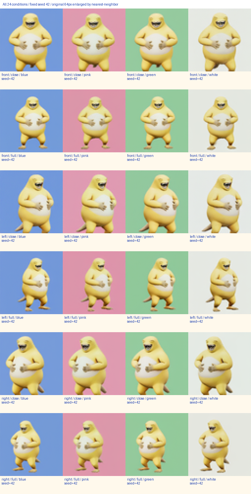
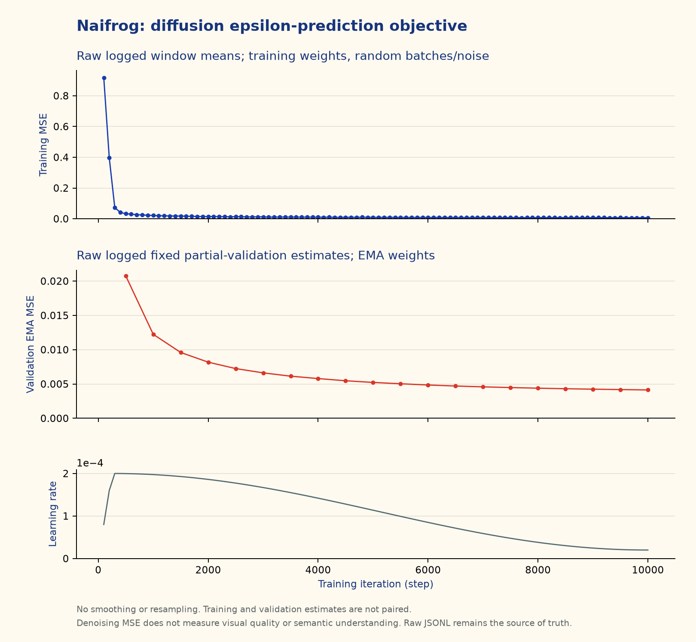

# 奶蛙文生图：从头训练的扩散模型

一个可以读懂、训练并检查结果的小型中文文生图实验。**模型从头初始化，未加载任何预训练参数**：主体权重随机初始化，输出卷积的权重和偏置初始化为零；归一化参数、部分偏置和 PAD 字符嵌入采用 PyTorch 的常量初值。用 4,080 张角色渲染图训练，输出真实的 **64×64 RGB 图片**。

提示词示例：`奶蛙捧腹大笑，左前方视角，全身，粉色背景`。



这些图片来自已训练网络的扩散采样。上图采用最近邻放大便于查看，没有使用超分辨率模型。训练范围是同一个角色的 24 种视角、构图、背景组合，不是通用绘画模型，也不输出三维模型。

## 下载代码与权重

```bash
git clone https://github.com/Hanchenk/naifrog-diffusion.git
cd naifrog-diffusion
python -m venv .venv
source .venv/bin/activate
pip install -r requirements.txt
mkdir -p weights
curl -fL https://github.com/Hanchenk/naifrog-diffusion/releases/download/v1.0.0/naifrog_ema.pt \
  -o weights/naifrog_ema.pt
```

权重通过 GitHub Release 附件分发，不写入 Git 历史。大小 **37,840,187 字节**，SHA256：

```text
5445e9ef7fca9c1b47a1c235995d09b7aaaadcd3974290d6c9d5fd751e64777e
```

CUDA 环境请按自己的驱动和硬件安装兼容的 PyTorch；CPU 也能推理与运行小规模数值检查。原实验环境是 NVIDIA RTX A5500、PyTorch 2.12.1+cu130。公开代码使用 PyTorch 2.7 及以上的 API。

## 立即生成

```bash
python model_code/infer.py --checkpoint weights/naifrog_ema.pt \
  --prompt '奶蛙捧腹大笑，左前方视角，全身，粉色背景' \
  --out outputs/result.png --process outputs/process.png \
  --seed 42 --steps 50 --guidance 2.5 --device cuda:0
```

没有 GPU 时改为 `--device cpu`。输出 `result.png` 保持 64×64 原始分辨率；`process.png` 是真实采样中间状态的联系表，另保存提示词、seed、采样参数等 JSON 元数据。

受支持的提示词模板是：

```text
奶蛙捧腹大笑，{正面|左前方|右前方}视角，{近景|全身}，{蓝色|粉色|绿色|白色}背景
```

`guidance=1` 是普通有条件预测，默认 2.5 加强条件引导；可从 1–3 比较。`--steps 50` 使用确定性 DDIM（eta=0）。固定设备和运行环境下，同一个 seed 可复现结果；不同 PyTorch/CUDA 版本不承诺逐位相同。训练词表之外的字符会警告并映射到 UNK；词表内的新句子同样不保证能理解。

## 网络如何学习

1. 将图片归一化到 [-1,1]，随机选时间步 `t`，抽取标准高斯噪声 `epsilon`。
2. 按 `x_t = sqrt(alpha_bar_t)*x_0 + sqrt(1-alpha_bar_t)*epsilon` 加噪。
3. 中文字符经过从零学习的 embedding 和小 Transformer；U-Net 在 16×16、8×8 特征层用交叉注意力读取文字。
4. 网络预测 `epsilon_theta(x_t,t,c)`，最小化与真实 epsilon 的 MSE，通过反向传播同时更新图像网络和文本网络。
5. 训练时以 15% 概率置空文字，使同一网络学会有条件与无条件预测；推理时用 CFG 组合两者，再逐步去噪。

U-Net 基础通道为 48，文本宽度 128、2 层，模型共 **9,436,083 个参数**。使用 1,000 步 cosine 加噪日程、AdamW、AMP、梯度裁剪和 EMA。采样采用带预测 x0 裁剪的 DDIM 变体。精确论文、公式页码和实现差异见 [PAPERS.md](PAPERS.md)。这是像素空间模型，没有 VAE，因此不是 LDM/Stable Diffusion。

## 从头制作训练数据

仓库不打包用户原始 FBX、转换后的 GLB 或完整训练集。**运行已发布权重不需要三维资产。** 如需复现数据制作，把自己有使用权的带材质角色 GLB 放入 `assets/character.glb`，见 [资产说明](assets/README.md)。

```bash
npm install
npx playwright install chromium
python -m http.server 8766
```

保留上述静态服务，在另一个终端进入仓库运行：

```bash
npm run render-data
npm run inspect-data
```

渲染器先产生 128×128 图，再用 Lanczos 缩为 64×64。默认产生 4,080 张训练图、504 张验证图，每个离散条件分别有 170/21 个连续扰动种子。相机角度、构图、背景色和光照微扰都有种子记录；两个划分使用不同种子，但包含相同角色和全部 24 种条件。渲染设备、资产或浏览器变化不保证像素级一致。

如果已安装 Chrome，可设置 `BROWSER_CHANNEL=chrome`；静态服务地址变化时用 `RENDER_URL` 指定完整渲染页面地址。依赖已在 `package.json` 固定版本。

也可以自行准备 PNG 和 JSONL；每行至少包含：

```json
{"image":"images/train/000000.png","caption":"奶蛙捧腹大笑，正面视角，全身，蓝色背景","view":"front","framing":"full","background":"blue","seed":1000000}
```

图像路径相对于 JSONL 所在目录。训练仅依赖 image/caption；评价工具还使用 view/framing/background/seed。

## 从头训练

```bash
python model_code/train.py --data data/train.jsonl --val-data data/val.jsonl \
  --out runs/naifrog --device cuda:0 --steps 10000 --batch-size 64 \
  --cache gpu --lr 0.0002 --seed 2026 --log-every 100 \
  --sample-every 1000 --save-every 1000 --eval-every 500
```

数据以 uint8 缓存在 GPU，抽取 batch 后再归一化；显存不足时先减小 batch。`runs/naifrog` 包含完整检查点、词表、配置、原始指标 JSONL 和固定提示词采样图。恢复自己训练的运行时：

```bash
python model_code/train.py --data data/train.jsonl --val-data data/val.jsonl \
  --out runs/naifrog --resume runs/naifrog/checkpoints/latest.pt --steps 15000
```

`--steps` 是目标总步数，扩展训练会按新的总步数计算学习率。Release 中的 `naifrog_ema.pt` 仅含 EMA 推理参数和模型元数据，不含优化器，不能直接作为恢复训练检查点；恢复训练需使用自己运行产生的完整 `latest.pt`。

## 实测结果与评价

本次完成 10,000 步、batch 64，共抽取 640,000 次训练图片；最后一条训练日志记录 888.28 秒，峰值已分配 GPU 显存 2.992 GiB。它们是这一次设备、数据与软件环境的实测值，不是普遍速度保证。

| 检查 | 本次结果 | 说明 |
|---|---:|---|
| 最后一个训练日志窗口 MSE | 0.00722645 | 训练权重、随机 batch/噪声 |
| 最后一次周期验证 EMA MSE | 0.00413186 | 固定的 256 张部分验证图 |
| 全部 504 张验证图，正确条件 MSE | 0.00364507 | EMA、FP32、每图固定噪声/时间步 |
| 同一 504 张图，错误条件 MSE | 0.02656326 | 仅替换为其他训练 captions |
| 正确条件的 MSE 更低 | 492 / 504 | 97.62%，描述性配对检查 |
| 72 张生成图的背景匹配 | 72 / 72 | 仅看四角 RGB 最近背景中心 |
| 72 张生成图的训练集完全相同 RGB | 0 / 72 | 不足以证明没有记忆 |

去噪 MSE 不等于视觉质量或通用语义能力。背景匹配没有评价角色形状；像素最近邻对相机、对齐和光照敏感，也不能单凭非零距离证明未记忆。训练和验证都是同一角色的合成视图，不能推断模型能泛化到其他角色、没见过的构图或开放领域提示词。详细原始数字见 [模型卡](MODEL_CARD.md) 和 [reports](reports/)。



运行评价：

```bash
python model_code/verify.py --device cpu
python evaluation/full_validation.py --checkpoint weights/naifrog_ema.pt \
  --train data/train.jsonl --val data/val.jsonl --out outputs/full_validation.json
python evaluation/generate_combinations.py --model-code model_code \
  --checkpoint weights/naifrog_ema.pt --out outputs/generated \
  --seed 42 --seed 123 --seed 2026
python evaluation/evaluate.py --train data/train.jsonl \
  --generated outputs/generated/generated.jsonl --out outputs/evaluation
python evaluation/plot_training.py --metrics runs/naifrog/metrics.jsonl \
  --out outputs/training_curves.png
```

数值检查包括固定样本目标下降、文本梯度、padding 屏蔽、已知真实噪声的 oracle DDIM、检查点往返、固定 seed 重复与 CFG=0 的无条件一致性。通过数值检查不代表所有生成结果都正确。

公开发布后已再次从 GitHub 克隆代码、下载 Release 权重并复跑数值验证和推理，生成结果与原实验逐像素一致。复用已有 PyTorch 环境，未重新安装全部依赖；记录见 [公开版本复跑报告](reports/public_release_smoke.json)。

## 目录

```text
model_code/      中文注释的网络、训练、推理、数值验证
dataset_tools/   浏览器渲染与数据重复/条件分布检查
evaluation/      全验证集 MSE、条件对照、72 图生成与像素评价
reports/         去除内部路径后的原始指标、配置与验收数据
examples/        少量真实生成图、对照图和曲线
assets/          自备三维资产的说明，不包含角色模型
release-assets/ Release 附件说明；权重文件被 gitignore
```

## 许可

代码和本项目发布的模型权重采用 [MIT License](LICENSE)。此许可不授予原角色形象、商标或用户三维资产等第三方权利；仓库没有重新分发原始角色模型或完整渲染数据集。作者：Hanchenk。
